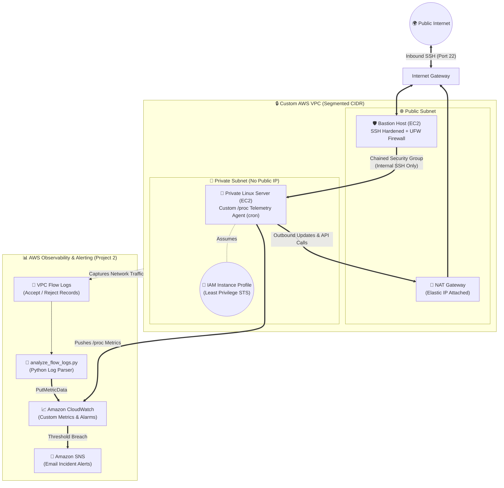

<div align="center">

# ☁️ AWS Network & Observability Lab
### Automated VPC Infrastructure & Linux Telemetry with Python (`boto3`)

[](https://aws.amazon.com/)
[](https://www.python.org/)
[](https://boto3.amazonaws.com/v1/documentation/api/latest/index.html)
[](https://ubuntu.com/)

<p align="center">
  <em>An end-to-end cloud engineering lab bridging networking, Linux internals, and Python automation into one connected, self-testing AWS environment.</em>
</p>

[Architecture](#-system-architecture) •
[Modules](#-repository-modules) •
[Engineering Deep Dive](#-engineering--learning-journey) •
[Quick Start](#-quick-start--execution-guide) •
[Troubleshooting](#-troubleshooting--lessons-learned)

</div>

---

## 🎯 Overview & Motivation

Cloud tutorials often teach AWS services in isolation—clicking through the console to spin up an EC2 instance one day, or reading about CIDR blocks the next. I built this repository to understand how **networking, Linux systems administration, Python, and AWS fit together** as a single cohesive system rather than four disconnected tutorials.

Instead of relying on manual console clicks ("ClickOps") or jumping straight into high-level abstractions before understanding the underlying API calls, I automated the entire lifecycle using **Python and the AWS SDK (`boto3`)**[cite: 1]. Building imperative provisioning, verification, and teardown scripts from scratch forced me to confront how AWS resources depend on one another, how state is tracked, and how network packets traverse security boundaries.

> [!NOTE]
> **Learning & Engineering Scope:** I built this lab to master cloud infrastructure fundamentals from the ground up rather than claim production scale[cite: 1]. Every roadblock—from WSL file permissions to VPC Flow Log delays—is documented below[cite: 1].

---

## 🏗️ System Architecture

Project 2's observability pipeline layers directly on top of Project 1's segmented network foundation[cite: 1]:



---

## 📂 Repository Modules

| # | Module Directory | Core Architecture Focus | Technologies & Concepts Practiced |
| :-: | :--- | :--- | :--- |
| **01** | [**`project1-secure-vpc`**](project1-secure-vpc/) | **Segmented VPC & Compute Hardening** | Custom VPC, CIDR subnetting, public/private route tables, NAT Gateway, Security Group chaining, Bastion host, SSH hardening, `ufw` host firewall, `boto3` provisioning, self-testing infrastructure (`verify.py`)[cite: 1]. |
| **02** | [**`project2-monitoring`**](project2-monitoring/) | **Telemetry, Flow Logs & Alerting** | VPC Flow Logs, Python log analysis, custom CloudWatch metrics scraped from Linux `/proc`, `cron` scheduling, least-privilege IAM Roles, CloudWatch Alarms, Amazon SNS email notifications[cite: 1]. |

---

## 🧠 Engineering & Learning Journey

### 1️⃣ Programmatic Infrastructure & State Management (`boto3`)
Automating AWS via Python revealed everything the AWS Management Console hides behind a single "Launch" button:
* **Asynchronous Dependency Ordering:** Provisioning a network programmatically requires strict sequencing. You cannot attach an Internet Gateway before the VPC exists, nor can you route private traffic to a NAT Gateway before it transitions from `pending` to `available`.
* **Local State Serialization:** Because `boto3` is an imperative SDK, tearing down or modifying resources requires tracking generated IDs (`vpc-xxx`, `subnet-xxx`, `igw-xxx`). My deployment scripts serialize resource metadata into `state.json` and `monitoring_state.json`[cite: 1].
* **Reverse-Dependency Teardown:** Deleting a VPC fails with a `DependencyViolation` if an Elastic IP is still bound to a NAT Gateway or if network interfaces (ENIs) haven't finished detaching. Writing `teardown.py` taught me how to unwind the resource graph cleanly so zero billable resources are left behind[cite: 1].

### 2️⃣ Defense-in-Depth Networking (`project1-secure-vpc`)
* **Asymmetric Routing Boundaries:** Configured explicit route tables where the public subnet routes `0.0.0.0/0` to an Internet Gateway, while the private subnet routes outbound traffic through a public NAT Gateway—allowing the private server to reach AWS APIs and OS package mirrors without ever exposing a public IP[cite: 1].
* **Perimeter + Host Security:** Chained AWS Security Groups so the private instance only accepts SSH traffic originating from the Bastion Host's Security Group, then reinforced the Linux OS layer using `ufw` firewall rules and hardened SSH configurations[cite: 1].
* **Self-Testing Infrastructure (`verify.py`):** Engineered an automated verification suite that actively probes the deployed topology to prove the Bastion is reachable, private outbound NAT routing works, and unauthorized access paths are blocked[cite: 1].

### 3️⃣ Linux Internals, Least-Privilege IAM & Observability (`project2-monitoring`)
* **Linux `/proc` Telemetry Agent:** Rather than treating monitoring agents as a black box, I wrote a custom Python script scheduled via `cron` that reads raw kernel statistics directly from the Linux `/proc` pseudo-filesystem and publishes custom metric dimensions to CloudWatch[cite: 1, 3].
* **Zero Hardcoded Credentials:** Attached a least-privilege **IAM Role / Instance Profile** to the EC2 instance so `boto3` fetches temporary rotating credentials automatically instead of storing static AWS keys on disk[cite: 1, 3].
* **Traffic Simulation & Flow Log Parsing:** Built `generate_test_traffic.py` to trigger both accepted and rejected network flows, then wrote `analyze_flow_logs.py` to parse raw VPC Flow Logs, publish custom metrics, and trigger **CloudWatch Alarms** wired to **Amazon SNS** email alerts[cite: 1].

---

## ⚡ Quick Start & Execution Guide

### Prerequisites
* **AWS Account & IAM:** Configure a dedicated **IAM User** (never use the root account) via `aws configure`, and set a **$5.00 AWS Budget billing alarm** first (`Billing > Budgets`)[cite: 1].
* **Python Environment:** Python `3.9+` with `boto3` installed (`pip install boto3`)[cite: 1].
* **Shell Environment:** Linux, macOS, or **WSL (Ubuntu)** on Windows[cite: 1].

> [!IMPORTANT]
> **Windows WSL Users:** Clone this repository inside your native WSL Linux home directory (`~/`), **not** inside `/mnt/c/...`[cite: 1]. Windows NTFS mount permissions prevent `chmod 400` from locking down your `.pem` SSH private key, which causes OpenSSH to reject the connection[cite: 1].

### Step-by-Step Deployment

```bash
# =========================================================================
# PHASE 1: Provision & Verify the Hardened VPC + Compute Foundation
# =========================================================================
cd project1-secure-vpc
pip install -r requirements.txt

python deploy.py                 # Provisions VPC, Subnets, NAT GW, Bastion & Private EC2 (~5 min)
python verify.py                 # Runs automated connectivity & firewall lockdown assertions

# =========================================================================
# PHASE 2: Deploy Telemetry Agent, VPC Flow Logs & SNS Alerting
# =========================================================================
cd ../project2-monitoring

python setup_monitoring.py --email you@example.com   # Configures IAM, Flow Logs, Alarms & SNS
python install_agent.py                              # Deploys /proc telemetry agent & cron job
python generate_test_traffic.py                      # Generates synthetic accept/reject traffic

# ⏳ Wait ~10 minutes for AWS to flush VPC Flow Log intervals to CloudWatch
python analyze_flow_logs.py --publish                # Parses Flow Logs & publishes custom metrics

# =========================================================================
# PHASE 3: Clean Up (CRITICAL: Execute in reverse order!)
# =========================================================================
python teardown_monitoring.py
cd ../project1-secure-vpc && python teardown.py
```

---

## 💰 FinOps & Cost Guardrails

> [!WARNING]
> **NAT Gateway Hourly Charges:** The AWS **NAT Gateway costs ~$0.045/hour (~$1.08/day) plus per-GB data processing fees** immediately upon creation, and EC2 instances may incur charges outside the AWS Free Tier[cite: 1]. Always run both teardown scripts in reverse order at the end of a lab session, and visually verify the **VPC, EC2, and NAT Gateway** consoles to confirm zero resources remain active[cite: 1].

---

## 🛠️ Troubleshooting & Lessons Learned

<details>
<summary><b>1. Why does <code>chmod 400</code> fail on my SSH key in WSL?</b> <i>(Click to expand)</i></summary>
<br/>

When running Ubuntu on Windows via WSL, files stored under `/mnt/c/...` use the Windows NTFS filesystem driver, which defaults to permissive metadata and ignores standard POSIX `chmod 400` commands[cite: 1]. OpenSSH refuses to use a `.pem` key if it is readable by other users. Cloning the repository inside the native Linux filesystem (`~/`) resolves this immediately[cite: 1].
</details>

<details>
<summary><b>2. Why does <code>analyze_flow_logs.py</code> return empty results right after generating traffic?</b> <i>(Click to expand)</i></summary>
<br/>

VPC Flow Logs do not stream packet-by-packet in real time; AWS aggregates flow records over capture windows and takes roughly **10 minutes** to flush and index those records before they can be queried by `analyze_flow_logs.py`[cite: 1].
</details>

<details>
<summary><b>3. What files should never be committed to Git?</b> <i>(Click to expand)</i></summary>
<br/>

The following sensitive keys and runtime state files are excluded via `.gitignore` and must never be committed[cite: 1]:
* `*.pem` — Private SSH keys generated during EC2 provisioning[cite: 1].
* `state.json` — Local resource ID mapping for Project 1[cite: 1].
* `monitoring_state.json` — Local ARN and resource mapping for Project 2[cite: 1].
</details>