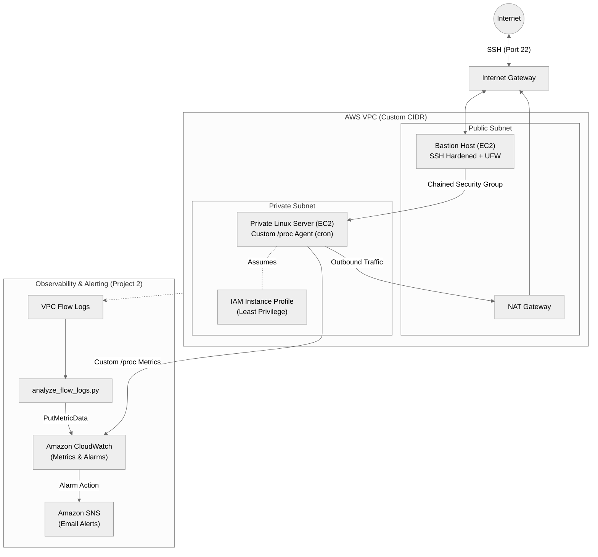

# AWS Network & Observability Lab
**Automated VPC Infrastructure and Linux Telemetry with Python (`boto3`)**

[Overview](#overview) · [Architecture](#system-architecture) · [Project Structure](#project-structure) · [Engineering Notes](#engineering--learning-notes) · [Quick Start](#quick-start) · [Troubleshooting](#troubleshooting--cleanup)

---

## Overview

Most introductory cloud tutorials teach AWS services in isolation. I built this repository as a learning project to understand how **networking, Linux systems administration, Python, and AWS fit together** by engineering one connected, end-to-end system rather than four disconnected tutorials[cite: 1].

Instead of relying on manual console configuration, the entire lifecycle—provisioning, connectivity verification, telemetry collection, and teardown—is automated using **Python (`boto3`)**[cite: 1, 3]. Building the system programmatically required handling resource dependencies, tracking local state, configuring host-level and perimeter firewalls, and working with least-privilege IAM roles[cite: 1, 3].

---

## System Architecture

Project 2 layers an observability and alerting pipeline directly on top of Project 1's segmented network foundation[cite: 1].



---

## Project Structure

| Module | Directory | Core Focus & Concepts Practiced |
| :--- | :--- | :--- |
| **Part 1** | [`project1-secure-vpc`](project1-secure-vpc/) | VPC design, CIDR planning, public/private subnets, NAT Gateway routing, chained security groups, bastion host architecture, SSH hardening, `ufw` host firewall rules, `boto3` automation, and self-testing infrastructure (`verify.py`)[cite: 1, 3]. |
| **Part 2** | [`project2-monitoring`](project2-monitoring/) | VPC Flow Logs, parsing network logs with Python, scraping custom CloudWatch metrics from Linux (`/proc`) via `cron`, least-privilege IAM roles, CloudWatch alarms, and SNS email alerts[cite: 1, 3]. |

---

## Engineering & Learning Notes

### 1. Programmatic Provisioning & State Tracking (`boto3`)
Automating infrastructure with an imperative SDK exposes resource dependencies that the AWS Console normally abstracts away:
* **Dependency Ordering:** Subnets, route tables, Internet Gateways, and NAT Gateways must be provisioned and awaited in sequence before routing rules or EC2 instances can be attached[cite: 1, 3].
* **State Management:** Generated resource identifiers (`vpc-xxx`, `subnet-xxx`, ARNs) are written locally to `state.json` and `monitoring_state.json` so subsequent verification and teardown scripts can reference the exact environment[cite: 1, 3].
* **Clean Teardown:** Tearing down a VPC requires detaching and deleting dependent resources in strictly reversed order (`teardown_monitoring.py` followed by `teardown.py`) to avoid dependency locks and prevent orphaned, billable resources[cite: 1, 3].

### 2. Defense-in-Depth Networking (`project1-secure-vpc`)
* **Network Segmentation:** The public subnet routes internet-bound traffic through an Internet Gateway, while the private subnet isolates the backend server and routes outbound traffic (for package updates and AWS API calls) through a NAT Gateway[cite: 1, 3].
* **Layered Access Control:** At the AWS perimeter, the private server's security group only accepts inbound SSH from the bastion host's security group[cite: 1, 3]. At the OS level, access is further locked down via `ufw` host firewall rules and hardened SSH settings[cite: 1, 3].
* **Automated Verification:** Running `verify.py` tests the live infrastructure to confirm that routing works as intended and unauthorized paths are blocked[cite: 1, 3].

### 3. Linux Telemetry & Least-Privilege IAM (`project2-monitoring`)
* **Kernel Metrics from `/proc`:** Instead of relying solely on default hypervisor metrics, a custom Python script scheduled via `cron` reads raw system metrics directly from the Linux `/proc` filesystem and publishes them to CloudWatch[cite: 1, 3].
* **IAM Instance Profiles:** Rather than storing static AWS credentials on the server, the EC2 instance assumes a least-privilege IAM role to push metrics securely[cite: 1, 3].
* **Flow Log Analysis & Alerting:** After generating synthetic test traffic (`generate_test_traffic.py`), `analyze_flow_logs.py` parses VPC Flow Logs to identify anomalous or rejected traffic and publishes metrics to CloudWatch, triggering SNS email notifications when alarm thresholds are crossed[cite: 1, 3].

---

## Quick Start

### Prerequisites
* **AWS Account:** Set up a billing alarm first (`Billing > Budgets`, e.g., $5)[cite: 1]. Configure a non-root **IAM user** with programmatic access via `aws configure`[cite: 1].
* **Python:** Python 3.9+ with `boto3` installed (`pip install boto3`)[cite: 1].
* **Shell Environment:** A Linux shell[cite: 1]. On Windows, use **WSL (Ubuntu)** and clone this repository inside your native WSL home directory (`~/`), **not** `/mnt/c/...`, otherwise `chmod 400` on the generated `.pem` SSH key will not work properly[cite: 1].

### Execution Order

```bash
# 1. Deploy and verify the VPC and compute layer (~5 min)
cd project1-secure-vpc
pip install -r requirements.txt
python deploy.py
python verify.py

# 2. Configure monitoring, deploy the /proc agent, and test flow logs
cd ../project2-monitoring
python setup_monitoring.py --email you@example.com
python install_agent.py
python generate_test_traffic.py

# Wait ~10 minutes for VPC Flow Logs to aggregate and publish before running:
python analyze_flow_logs.py --publish

# 3. Clean up (Always run in reverse order)
python teardown_monitoring.py
cd ../project1-secure-vpc && python teardown.py
```

---

## Troubleshooting & Cleanup

**Cost Management**
The **NAT Gateway costs approximately $0.045/hour (~$1/day) plus data processing fees**, and EC2 instances may incur charges outside the free tier[cite: 1]. Always execute the teardown scripts at the end of a session, then inspect the VPC, EC2, and NAT Gateway consoles to verify that all resources have been terminated[cite: 1].

**Git Hygiene**
Never commit generated keys or local state files (`*.pem`, `state.json`, `monitoring_state.json`); all three are excluded via `.gitignore`[cite: 1].

<details>
<summary><b>Why does SSH key permission (<code>chmod 400</code>) fail on Windows WSL?</b></summary>
<br/>
Cloning the repository inside the mounted Windows filesystem (<code>/mnt/c/...</code>) applies Windows NTFS permission rules, which prevents <code>chmod 400</code> from restricting the <code>.pem</code> file and causes SSH to reject the key[cite: 1]. Cloning inside the native WSL home directory (<code>~/</code>) resolves this[cite: 1].
</details>

<details>
<summary><b>Why does <code>analyze_flow_logs.py</code> show no data immediately after running <code>generate_test_traffic.py</code>?</b></summary>
<br/>
VPC Flow Logs capture network traffic in aggregation windows rather than streaming instantaneously[cite: 1]. Wait roughly 10 minutes after generating test traffic before running the analyzer script[cite: 1].
</details>